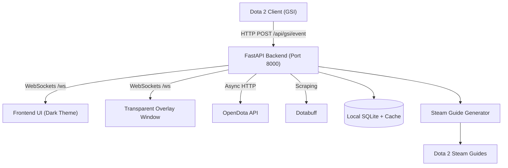

# ⚡ DotaBlitz – Dota 2 Companion App

**DotaBlitz** is a high-performance desktop companion app for **Dota 2** inspired by Blitz.gg. It monitors your game in real-time via Valve's **Game State Integration (GSI)**, recommends optimal builds from high-level Divine & Immortal matches, displays an in-game assistant overlay, and generates Steam Community Guides.

---

## 🎯 Core Features

- 🎮 **Automatic Hero Detection (GSI):** Detects your picked hero the moment you lock in during drafting.
- 📊 **Multi-Source Ranked Builds:** Aggregates and weights real data from **OpenDota API** and **Dotabuff** (Immortal + pro match focus).
- 🏆 **4 Tailored Build Archetypes:**
  - **Most Popular:** Largest sample size across the player base.
  - **Highest Winrate:** Top-performing item & skill builds.
  - **Immortal Meta:** What high-MMR and pro players are running in the current patch.
  - **Situational:** Alternative match-up choices.
- ⚡ **Live In-Game Assistant & Overlay:**
  - Real-time indicator of which skill to level next.
  - Next target items to purchase and gold milestones.
  - Power spike alerts (Level 6 ultimate, 15m core item timings).
  - Standalone transparent overlay window for borderless windowed mode.
- 📝 **Steam Community Guide Generator:**
  - Generates ready-to-use Steam Workshop guide text.
  - Copy directly or export as a `.txt` file into your Dota 2 client directory.

---

## 🏗️ System Architecture



---

## 🚀 Quick Start & Installation

### Windows (Automated)

1. Double click `scripts/setup.bat` (or run it from CMD/PowerShell).
2. It will:
   - Create a Python virtual environment (`venv`).
   - Install all required dependencies (`requirements.txt`).
   - Detect your Steam library and automatically install `gamestate_integration_dotablitz.cfg` into your Dota 2 cfg folder.
3. Start the application:
   ```powershell
   .\venv\Scripts\activate
   python run.py
   ```

### Manual Installation (Windows, Linux, macOS)

```bash
# 1. Create and activate virtual environment
python -m venv venv
# Windows:
.\venv\Scripts\activate
# Linux/macOS:
source venv/bin/activate

# 2. Install dependencies
pip install -r requirements.txt

# 3. Install Dota 2 GSI config
python scripts/install_gsi.py

# 4. Start the companion
python run.py
```

Open your browser at **`http://localhost:8000`**.

---

## 🕹️ Setting Up Dota 2 Game State Integration (GSI)

If `scripts/install_gsi.py` did not locate your folder automatically, copy:
`data/gsi/gamestate_integration_dotablitz.cfg`

To your Dota 2 configuration directory:
```
<Steam Directory>\steamapps\common\dota 2 beta\game\dota\cfg\gamestate_integration\gamestate_integration_dotablitz.cfg
```

Once copied, launch Dota 2. DotaBlitz will automatically detect when you enter matches!

---

## 🛠️ Tech Stack

- **Backend:** Python 3.11+, FastAPI (REST + WebSockets), SQLAlchemy 2.0 (async), aiosqlite, APScheduler.
- **Data Ingestion:** `httpx`, `BeautifulSoup4`, `pydantic-settings`.
- **Frontend:** Vanilla HTML5, modern CSS3 (custom esports dark theme), responsive CSS Grid, vanilla ES2022 JavaScript, FontAwesome.
- **Overlay:** HTML5 transparent window with `backdrop-filter: blur`.

---

## 🧪 Running Tests

```bash
pytest tests/unit
```

---

## 📄 License
MIT License.
